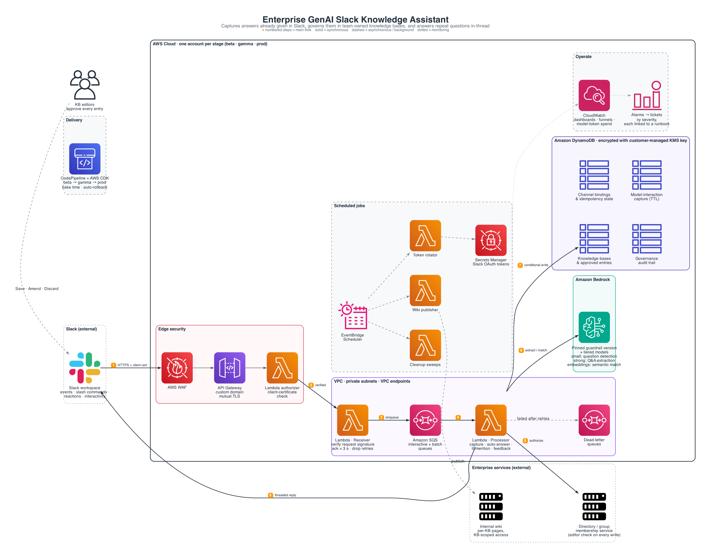
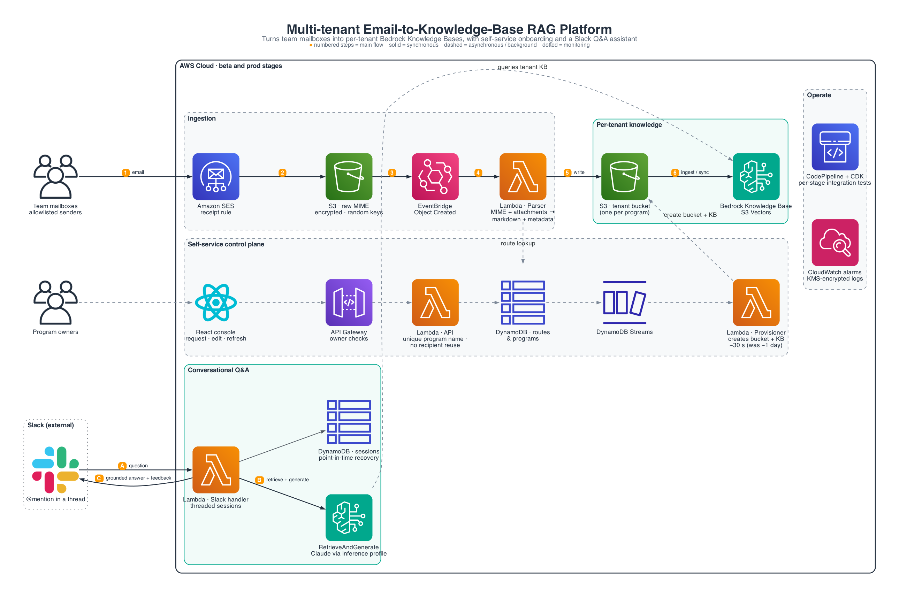
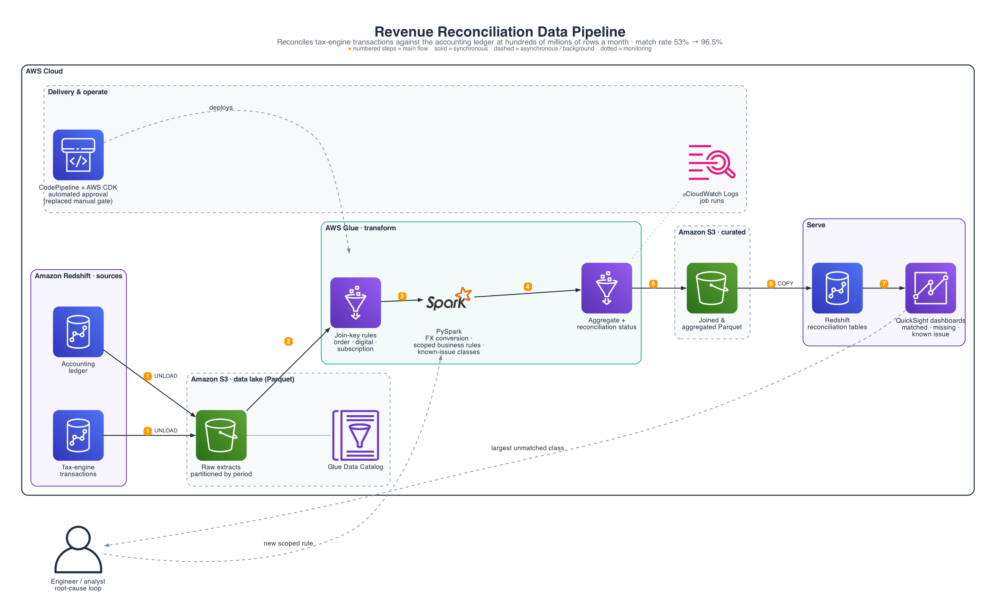
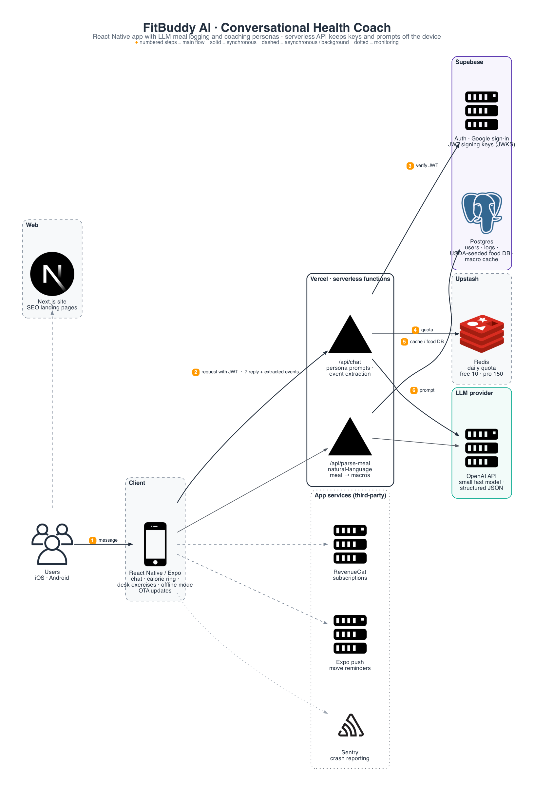
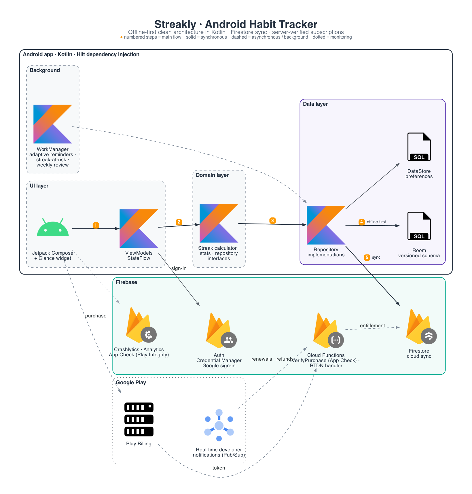
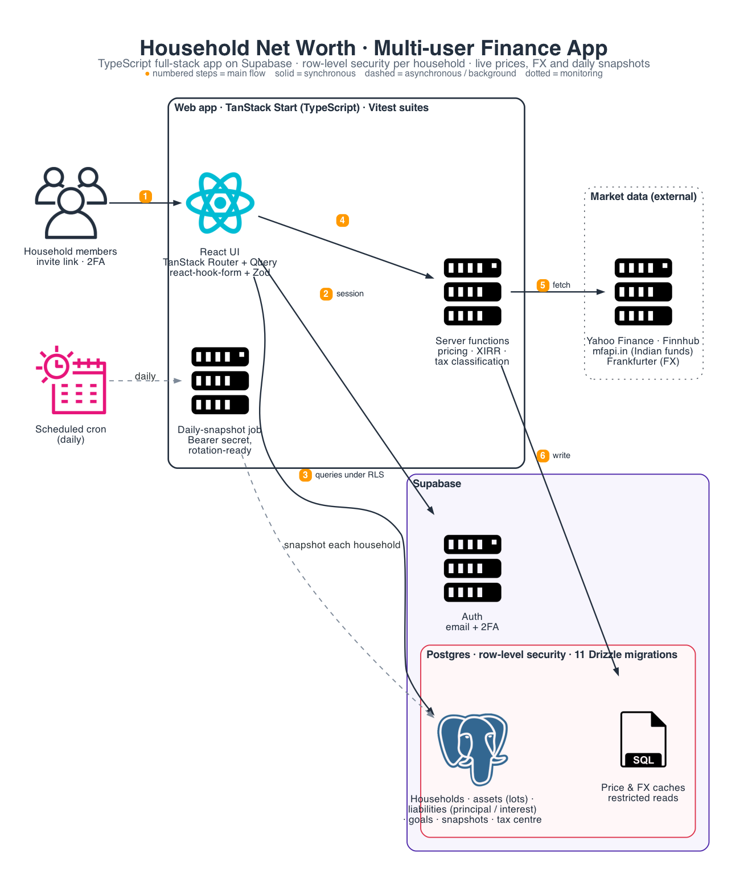
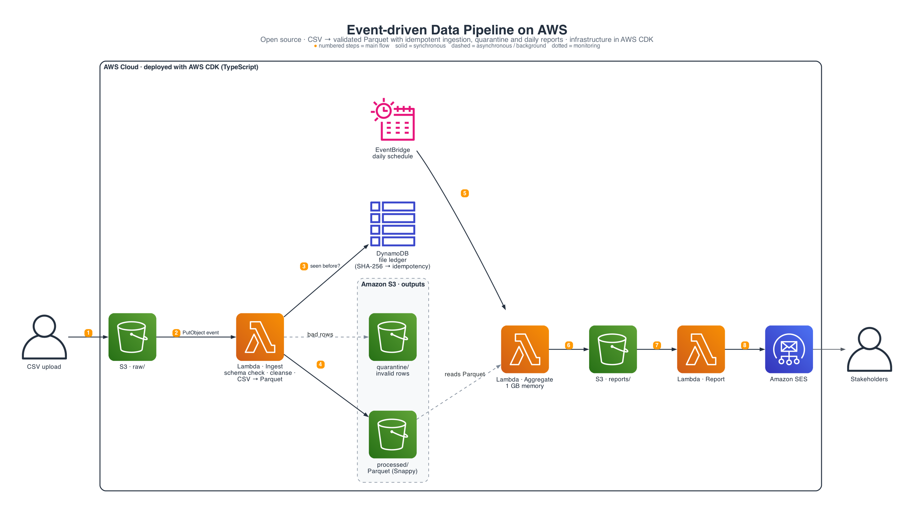

# Architecture Portfolio — Vinayak Mahajan

System designs I have built, drawn as code with [`diagrams`](https://diagrams.mingrammer.com/).
Professional projects are generalised: no proprietary code, data, internal names, or business figures, only the engineering.

**How to read the diagrams:** orange numbered badges follow the main request path, solid lines are synchronous calls, dashed lines are asynchronous or background work, and dotted lines are monitoring. Boxes show boundaries: AWS Cloud / platform (dark), VPC (purple), security (red), GenAI (teal), data stores (indigo), external systems (dotted).

| # | System | Type | Stack highlights |
|---|---|---|---|
| 1 | [Enterprise GenAI Slack knowledge assistant](#1-enterprise-genai-slack-knowledge-assistant) | Professional | Bedrock · Lambda · SQS · DynamoDB · mTLS · CDK |
| 2 | [Multi-tenant email-to-knowledge-base RAG platform](#2-multi-tenant-email-to-knowledge-base-rag-platform) | Professional | SES · EventBridge · Bedrock Knowledge Bases · React |
| 3 | [Revenue reconciliation data pipeline](#3-revenue-reconciliation-data-pipeline) | Professional | Redshift · S3/Parquet · Glue · PySpark · QuickSight |
| 4 | [FitBuddy AI](#4-fitbuddy-ai) | Personal | React Native/Expo · Vercel · LLM API · Supabase |
| 5 | [Streakly](#5-streakly) | Personal | Kotlin · Jetpack Compose · Room · WorkManager · Firebase |
| 6 | [Household Net Worth](#6-household-net-worth) | Personal | TypeScript · React · Supabase Postgres + RLS |
| 7 | [Event-driven data pipeline on AWS](#7-event-driven-data-pipeline-on-aws) | Open source | S3 · Lambda · DynamoDB · EventBridge · CDK |

---

## 1. Enterprise GenAI Slack knowledge assistant


**Problem.** Answers given in chat live in one thread of one channel, so the next person asks again and the same expert answers again.

**What I built.** I was the only engineer, from design to on-call. Team members save a good answer with one reaction. A model extracts self-contained Q&A pairs, an editor approves them, and the assistant answers repeat questions in-thread with credit to the original author. Each knowledge base is also published as a permissioned wiki page.

**Key decisions**
- **Verify at the edge, then acknowledge fast.** Mutual TLS and a WAF sit at the custom domain, and the receiver checks the request signature. Slack gets an acknowledgement within 3 seconds and the real work goes onto queues, with idempotent handling of platform retries.
- **The model never makes an access decision.** Authorisation is deterministic code that checks group membership on every write. The model only extracts and matches text.
- **Guardrails and model tiering.** A pinned guardrail version sits on every call. A small model detects questions, a stronger model extracts Q&A, and embeddings do semantic matching.
- **Data design.** DynamoDB tables for knowledge bases, channel bindings with idempotency state, a governance audit trail, and a TTL-expiring capture of problem model interactions. All are encrypted with a customer-managed KMS key and use conditional writes so concurrent edits can't overwrite each other.
- **A human approves everything.** No entry is stored without an editor's approval. Thumbs-up/down feedback surfaces weak answers for review.
- **Operable from day one.** Alarms on every component open tickets at the right severity and link to runbook sections. Guarded operator scripts cover the "break glass" actions.
- **Delivery.** Infrastructure is in AWS CDK, deployed through beta → gamma → prod in separate accounts with full continuous delivery. Before launch it had automated prompt-injection tests, a load test and failure drills.

**Outcome.** Prototype to security-approved production in about 9 weeks, through 100+ code reviews.

---

## 2. Multi-tenant email-to-knowledge-base RAG platform


**Problem.** Teams kept critical decisions in email, where nobody else could search them.

**What I built.** An ingestion pipeline that turns allowlisted team mailboxes into per-tenant Bedrock Knowledge Bases, with a self-service console and a Slack Q&A assistant.

**Key decisions**
- **Runtime routing.** Routing moved from a config file to a DynamoDB table with Streams. A provisioner creates each tenant's bucket and knowledge base automatically, so onboarding went from about a day of developer work to a 30-second form.
- **Tenant isolation.** Program names are unique, every request passes an owner check, and the API rejects reuse of a recipient address. This closed a cross-tenant takeover path.
- **Hardening.** Senders are allowlisted, filenames sanitised, objects get random keys to prevent overwrites, IAM is scoped to prefixes, and logs are encrypted with KMS.
- **Conversation.** Threaded @mentions keep session state in DynamoDB with point-in-time recovery, and RetrieveAndGenerate grounds answers in the tenant's knowledge base.

---

## 3. Revenue reconciliation data pipeline


**Problem.** Reconcile tax-engine transactions against the accounting ledger for a new market, at hundreds of millions of rows a month.

**What I built.** The package, infrastructure and CI/CD from scratch. Data is UNLOADed to a partitioned Parquet lake, AWS Glue/PySpark jobs apply join-key rules, FX conversion and business rules, results are aggregated and COPYed back to Redshift, and dashboards report each record as matched, missing or known issue.

**How accuracy went from 53% to 96.5%.** I used a root-cause loop: dashboards point at the largest unmatched class, I analyse it forensically, then write a rule or reclassification scoped so existing markets are untouched. Ten or more mismatch classes were fixed this way. The pipeline beat the established markets' benchmark and launched ahead of target. I also replaced a manual production approval with automated approval at the version-set stage.

---

## 4. FitBuddy AI


A conversational health coach for desk workers. You log meals in plain language ("had a chicken biryani for lunch"), choose from four coaching personas, track pain, and get targeted desk exercises.

- **Thin serverless API on Vercel.** The LLM key and the prompts never reach the device. Every request carries a Supabase JWT that the API verifies against the published signing keys (JWKS).
- **Cost control.** Per-tier daily quotas in Upstash Redis (free 10, pro 150). A macro cache keyed on the normalised message, plus a USDA-seeded food database, avoids repeat model calls.
- **App services.** RevenueCat subscriptions, Expo push reminders, OTA updates and Sentry crash reporting.

## 5. Streakly


An Android habit tracker built with clean architecture (UI → ViewModel → domain → data) in Kotlin, with Hilt for dependency injection.

- **Offline-first.** Data lives in Room with versioned schemas and syncs to Firestore. WorkManager drives adaptive reminders, "streak at risk" nudges and the weekly review. There's also a Glance home-screen widget.
- **Server-verified subscriptions.** Purchases go through Google Play Billing, then a Cloud Function verifies the token with App Check enforced. A second function handles Play real-time developer notifications (renewals, refunds) from Pub/Sub, and both write the entitlement to Firestore.
- **Sign-in and hardening.** Google sign-in through Credential Manager, plus Crashlytics, Analytics and App Check (Play Integrity).

## 6. Household Net Worth


A private finance app shared by a household, built as a full-stack TypeScript app on TanStack Start and Supabase.

- **Isolation.** Postgres row-level security means only household members can read or write their data. Price and FX caches have restricted reads, and the schema is managed through 11 versioned Drizzle migrations.
- **Market data.** Server functions fetch stocks and ETFs from Yahoo Finance and Finnhub, Indian mutual funds from mfapi.in, and FX rates from Frankfurter, then compute per-holding XIRR and tax classification.
- **Daily snapshots.** A scheduled job, authenticated with a Bearer secret that supports rotation, snapshots every household's net worth each day.
- **Tests.** Vitest suites cover finance, tax, import and market-close logic.

## 7. Event-driven data pipeline on AWS


Source: [aws-serverless-data-pipeline](https://github.com/AutomationUser22/aws-serverless-data-pipeline). An S3 event triggers ingestion. Each file's SHA-256 hash is recorded in DynamoDB, so retries and re-uploads are ignored. Bad rows are quarantined, data is stored as Parquet/Snappy, and a scheduled job aggregates it and emails a summary report.

---

### Regenerate
```bash
brew install graphviz
python3 -m venv .venv && .venv/bin/pip install -r requirements.txt
cd diagrams && for f in 0*.py; do ../.venv/bin/python "$f"; done
```
